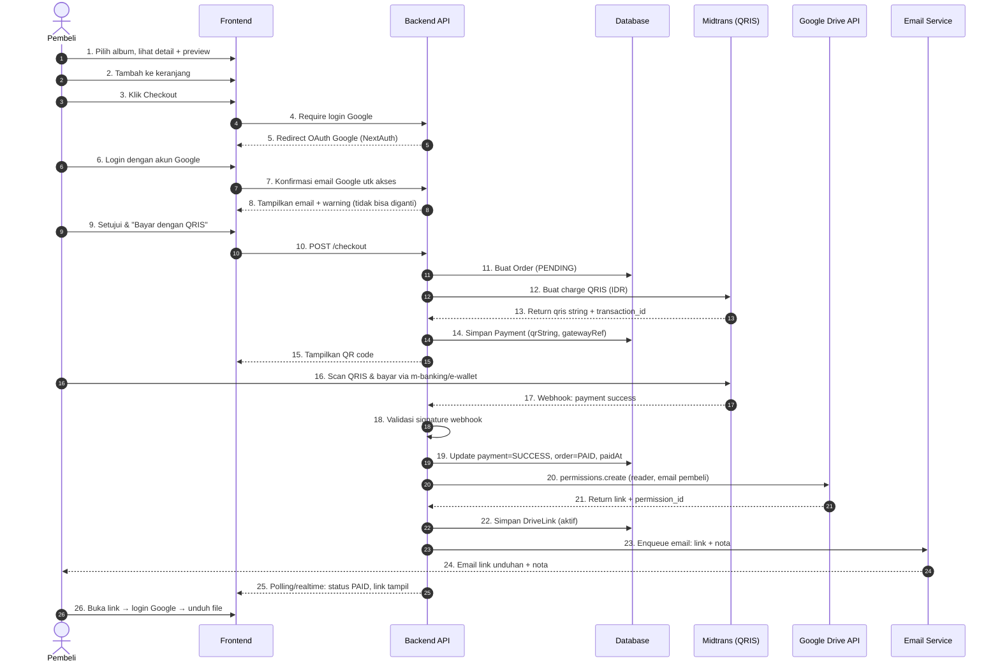
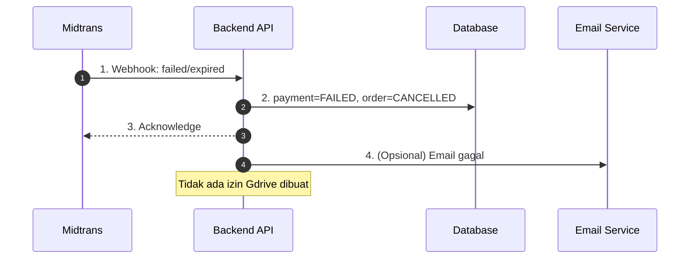
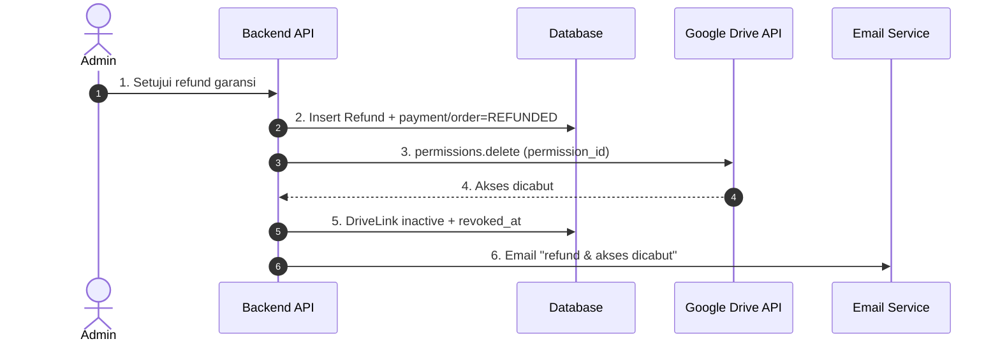
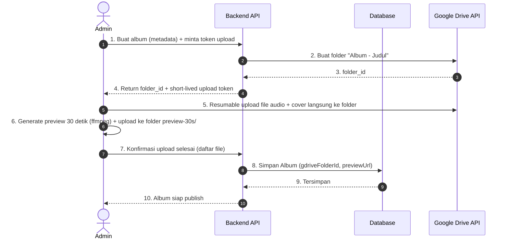

# PRD — Website Penjualan Album Musik High Audio (FINAL)

**Dokumen:** Product Requirements Document (PRD)
**Produk:** Toko digital album musik High Audio / Lossless
**Versi:** 2.1 (final — revisi teknis)
**Tanggal:** 2026-11-17
**Status:** Approved untuk implementasi

---

## 0. Ringkasan Dokumen

Dokumen ini adalah spesifikasi lengkap dan final untuk membangun **website penjualan album musik high audio**. Dokumen ini menggantikan seluruh versi sebelumnya dan sudah mencakup keputusan final berikut:

| Keputusan | Nilai final |
|-----------|-------------|
| **Metode pembayaran** | **QRIS saja** (via Midtrans) |
| **Akses file** | Wajib akun Google; izin `type=user` per email pembeli |
| **Refund** | Non-refundable, kecuali garansi (link rusak/tidak bisa diakses karena kesalahan penjual) |
| **Pasar & mata uang** | Indonesia, IDR |
| **Penyimpanan konten** | Google Drive (folder per album) |

> **Revisi v2.1:** memperbaiki kontradiksi teknis (hosting upload file besar, worker queue, idempotensi pemberian akses), mengoreksi validasi signature Midtrans, merekomendasikan Shared Drive, serta menambah alur preview 30 detik dan catatan PPN.

Dokumen ini ditulis agar tim engineering dapat langsung mengeksekusi tanpa ambiguitas: mencakup arsitektur, tech stack, skema database, daftar API, spesifikasi halaman, alur lengkap, dan kriteria penerimaan.

---

## 1. Ringkasan Eksekutif

Website menjual **album musik high audio** (FLAC, WAV, ALAC, DSD). Pembeli membayar **sekali** via **QRIS**, lalu mendapatkan **akses permanen** ke folder album di **Google Drive**.

**Cara kerja inti:**
1. Pembeli memilih album → login akun Google → checkout.
2. Sistem membuat order + meminta kode **QRIS** dari Midtrans.
3. Pembeli scan QRIS dan membayar.
4. Midtrans mengirim webhook `success`.
5. Sistem otomatis memberi izin folder Gdrive ke email Google pembeli.
6. Pembeli menerima email berisi link + nota, dan bisa mengakses kapan pun lewat "Pesanan Saya".

**Prinsip desain:**
- Semua alur berjalan **berurutan (sequential)** dan terekam.
- Konten **tidak pernah** di-hosting di server web — hanya di Google Drive.
- Akses terkontrol per email dan bisa dicabut saat refund garansi.

---

## 2. Tujuan & Sasaran (SMART)

| # | Tujuan | Target |
|---|--------|--------|
| 1 | Pembeli menerima akses Gdrive < 5 menit setelah pembayaran sukses | ≥ 99% order `paid` |
| 2 | Tingkat keluhan "link tidak bisa diakses" | < 1% |
| 3 | Conversion rate kunjungan → pembelian | ≥ 3% (bulan ke-3) |
| 4 | Waktu checkout sampai QRIS tampil | < 5 detik |
| 5 | Ketersediaan sistem | Uptime ≥ 99,5% |

---

## 3. Persona & Pengguna

| Persona | Deskripsi | Kebutuhan utama | Perangkat |
|---------|-----------|-----------------|-----------|
| **Pembeli (Audiophile)** | Punya akun Google, mencari file lossless resmi | Beli cepat via QRIS, tahu persis kualitas file, unduh mudah | Mobile & desktop |
| **Admin Toko** | Mengelola katalog, pesanan, refund | Upload album, pantau transaksi, kelola akses | Desktop |
| **Label / Penyedia Konten** | Menyuplai master album | Konten aman, distribusi terkontrol | — |

---

## 4. Ruang Lingkup

### 4.1 Dalam lingkup (In Scope)
- Katalog album + halaman detail (spesifikasi lengkap + preview 30 detik).
- Autentikasi Google (OAuth) untuk pembeli.
- Keranjang belanja.
- Checkout + pembayaran **QRIS** (Midtrans).
- Integrasi Google Drive API (buat folder, set izin, cabut izin).
- Otomatisasi pengiriman akses + nota setelah pembayaran terverifikasi.
- Halaman "Pesanan Saya" (akses ulang link).
- Admin panel (album, pesanan, refund/garansi, audit).
- Notifikasi email (konfirmasi, link + nota, garansi).
- Halaman FAQ & kontak.

### 4.2 Di luar lingkup (Out of Scope) — MVP
- Metode pembayaran selain QRIS (kartu, VA, e-wallet lain, PayPal).
- Streaming/preview penuh (hanya 30 detik).
- DRM / watermarking audio per pembeli.
- Aplikasi mobile native.
- Sistem langganan (subscription).

---

## 5. Asumsi & Ketergantungan

1. Akun Google dengan **Google Drive API** aktif (Service Account), kuota cukup. Gunakan **Google Workspace berbayar / Shared Drive** dengan kapasitas memadai (bukan Service Account gratisan ~15 GB), karena satu album lossless bisa mencapai beberapa GB.
2. Akun **Midtrans** terverifikasi dengan fitur **QRIS** aktif.
3. Webhook Midtrans tersedia dan dapat diterima server (URL publik HTTPS).
4. Konten album memiliki hak distribusi sah.
5. Pembeli memiliki akun Google dan aplikasi pembayaran QRIS (m-banking/e-wallet).

---

## 6. Arsitektur Sistem & Tech Stack

### 6.1 Diagram arsitektur

```
[Pembeli: Browser/HP]
        |
        v
[Next.js Frontend]  (SSR/SSG katalog, client-side keranjang)
        |
        v
[Next.js API Routes / Backend]
        |-----> [PostgreSQL + Prisma]  (data transaksi)
        |-----> [Redis + BullMQ]       (queue email, idempotency)
        |-----> [Midtrans API]         (buat charge QRIS + webhook)
        |-----> [Google Drive API]     (folder, izin, cabut izin)
        |-----> [Email Service (Resend/SMTP)]  (link + nota)
```

### 6.2 Tech stack yang direkomendasikan

| Lapisan | Teknologi | Alasan |
|---------|-----------|--------|
| Frontend | **Next.js 14 (App Router) + TypeScript + Tailwind CSS** | SEO katalog, cepat, satu bahasa dgn backend |
| Backend | **Next.js Route Handlers (API)** | Satu repo, satu deploy |
| Database | **PostgreSQL + Prisma ORM** | Relasional, transaksi kuat untuk order |
| Queue | **Redis + BullMQ** | Idempotensi webhook, kirim email tanpa blocking |
| Auth | **NextAuth.js (Google OAuth)** | Karena wajib akun Google, login satu klik |
| Pembayaran | **Midtrans QRIS API** | QRIS resmi, webhook andal |
| Storage | **Google Drive API (Service Account)** | Folder per album, izin per email |
| Email | **Resend / Nodemailer + SMTP** | Kirim transaksional |
| Hosting | **Vercel** (app + API serverless) + **Railway** (Postgres + worker BullMQ) + **Upstash** (Redis) | Murah & skalabel |

### 6.3 Environment variables (di `.env`)

```
DATABASE_URL=postgresql://...
REDIS_URL=redis://...
GOOGLE_CLIENT_ID=...
GOOGLE_CLIENT_SECRET=...
NEXTAUTH_SECRET=...
GDRIVE_SERVICE_ACCOUNT_JSON={...}   # atau path file
GDRIVE_ROOT_FOLDER_ID=...
MIDTRANS_SERVER_KEY=...
MIDTRANS_CLIENT_KEY=...
MIDTRANS_IS_PRODUCTION=false
EMAIL_FROM=support@domain.com
EMAIL_SMTP_URL=...
NEXT_PUBLIC_BASE_URL=https://domain.com
```

---

## 7. Skema Database (Detail)

### 7.1 Prisma Schema (ringkas)

```prisma
model User {
  id           String   @id @default(cuid())
  email        String   @unique
  name         String?
  role         Role     @default(BUYER)
  createdAt    DateTime @default(now())
  orders       Order[]
}

enum Role { BUYER ADMIN }

model Album {
  id              String   @id @default(cuid())
  title           String
  artist          String
  genre           String?
  description     String?
  coverUrl        String
  price           Int      // IDR, integer (rupiah)
  format          AudioFormat
  sampleRate      String   // "96 kHz"
  bitDepth        String   // "24-bit"
  totalSizeMb     Int
  trackCount      Int
  totalDuration   String   // "48:00"
  tracklist       Json     // [{no,title,duration}]
  previewUrl      String?  // preview 30 detik
  gdriveFolderId  String   @unique
  isPublished     Boolean  @default(false)
  createdAt       DateTime @default(now())
  orderItems      OrderItem[]
}

enum AudioFormat { FLAC WAV ALAC DSD }

model Order {
  id            String       @id @default(cuid())
  orderNumber   String       @unique
  userId        String
  user          User         @relation(fields: [userId], references: [id])
  totalAmount   Int
  taxAmount     Int          @default(0)
  status        OrderStatus  @default(PENDING)
  paymentStatus PaymentStatus @default(PENDING)
  accessStatus  AccessStatus @default(PENDING)
  items         OrderItem[]
  payment       Payment?
  driveLinks    DriveLink[]
  createdAt     DateTime     @default(now())
  paidAt        DateTime?
}

enum OrderStatus { PENDING PAID CANCELLED REFUNDED }
enum AccessStatus { PENDING GRANTING GRANTED FAILED }
enum PaymentStatus { PENDING SUCCESS FAILED REFUNDED }

model OrderItem {
  id            String  @id @default(cuid())
  orderId       String
  order         Order   @relation(fields: [orderId], references: [id])
  albumId       String
  album         Album   @relation(fields: [albumId], references: [id])
  priceSnapshot Int
}

model Payment {
  id          String        @id @default(cuid())
  orderId     String        @unique
  order       Order         @relation(fields: [orderId], references: [id])
  gateway     String        @default("midtrans")
  gatewayRef  String?       // transaction_id / order_id midtrans
  qrString    String?       // QRIS string utk render QR
  amount      Int
  status      PaymentStatus @default(PENDING)
  rawPayload  Json?
  verifiedAt  DateTime?
  createdAt   DateTime      @default(now())
}

model DriveLink {
  id           String    @id @default(cuid())
  orderId      String
  order        Order     @relation(fields: [orderId], references: [id])
  albumId      String
  folderId     String
  permissionId String
  linkUrl      String
  isActive     Boolean   @default(true)
  createdAt    DateTime  @default(now())
  revokedAt    DateTime?
}

model Refund {
  id          String        @id @default(cuid())
  orderId     String        @unique
  reason      String
  status      RefundStatus  @default(REQUESTED)
  requestedAt DateTime      @default(now())
  resolvedAt  DateTime?
  resolvedBy  String?
}

enum RefundStatus { REQUESTED APPROVED REJECTED DONE }
```

### 7.2 Catatan penting skema
- **Harga disimpan integer** (rupiah) untuk hindari floating point.
- **`orderNumber`** unik untuk referensi manusia & nota (mis. `ORD-20261116-XXXX`).
- **`priceSnapshot`** di `OrderItem` agar harga tidak berubah saat album naik harga.
- **`qrString`** disimpan untuk re-render QR bila halaman di-refresh sebelum bayar.
- **`accessStatus`** memisahkan "sudah bayar" (`PAID`) dari "akses sudah terkirim" (`GRANTED`). State `FAILED` memicu retry otomatis oleh worker.
- **Harga tampil sudah termasuk PPN**; `taxAmount` opsional untuk rincian nota (default 0 pada MVP).

---

## 8. Alur Utama (Sequence Diagram)

### 8.1 Pembelian — Happy Path (QRIS)



### 8.2 Pembayaran Gagal / Kedaluwarsa



### 8.3 Refund Garansi (Pencabutan Akses)



### 8.4 Admin Upload Album ke Gdrive

> **Catatan teknis (v2.1):** File audio lossless berukuran besar (ratusan MB–beberapa GB), sehingga **tidak** diupload lewat API serverless (batas body Vercel ~4,5 MB). Upload dilakukan **resumable langsung dari browser admin → Google Drive API** menggunakan short-lived token dari Service Account.



---

## 9. Spesifikasi API (Endpoint)

### 9.1 Public (tanpa login)

| Method | Endpoint | Deskripsi |
|--------|----------|-----------|
| GET | `/api/albums` | Daftar album published (dgn filter: genre, pencarian, sort, pagination) |
| GET | `/api/albums/:id` | Detail album + tracklist + spesifikasi |
| GET | `/api/albums/:id/preview` | Stream preview 30 detik (atau redirect ke URL preview) |

### 9.2 Pembeli (butuh auth Google)

| Method | Endpoint | Deskripsi |
|--------|----------|-----------|
| POST | `/api/cart` | Tambah item ke keranjang (DB, per user) |
| GET | `/api/cart` | Lihat isi keranjang |
| DELETE | `/api/cart/:itemId` | Hapus item keranjang |
| POST | `/api/checkout` | Buat order + charge QRIS, return `{orderId, qrString}` |
| GET | `/api/orders` | Riwayat order pembeli |
| GET | `/api/orders/:id` | Detail order + status + link (hanya jika PAID) |
| GET | `/api/orders/:id/status` | Polling status pembayaran (utk UI QR) |
| POST | `/api/refunds` | Ajukan garansi/refund (dengan reason) |

### 9.3 Webhook (dari Midtrans)

| Method | Endpoint | Deskripsi |
|--------|----------|-----------|
| POST | `/api/webhooks/midtrans` | Terima notifikasi status pembayaran; validasi signature |

### 9.4 Admin (butuh role ADMIN)

| Method | Endpoint | Deskripsi |
|--------|----------|-----------|
| POST | `/api/admin/albums` | Buat album + trigger upload Gdrive |
| PATCH | `/api/admin/albums/:id` | Update metadata album |
| DELETE | `/api/admin/albums/:id` | Hapus/unpublish album |
| GET | `/api/admin/orders` | List & filter semua order |
| POST | `/api/admin/refunds/:id/approve` | Setujui refund + cabut akses |
| POST | `/api/admin/refunds/:id/reject` | Tolak refund |
| GET | `/api/admin/audit` | Audit log akses & perubahan |

### 9.5 Catatan API
- Semua request auth pembeli memakai session NextAuth (cookie), bukan API key.
- Webhook Midtrans **wajib** divalidasi signature-nya sebelum diproses (HMAC-SHA512 dari `order_id + status_code + gross_amount` dengan **Server Key**).
- Endpoint checkout bersifat **idempoten** (retry tidak membuat order ganda).
- Keranjang disimpan di **database** (bukan session) agar konsisten antar perangkat.

---

## 10. Logika Bisnis Kunci (Pseudocode)

### 10.1 Checkout (buat order + QRIS)

```
fungsi checkout(userEmail, cartItems):
  mulai transaksi DB:
    order = buat Order(status=PENDING, total=jumlah(cartItems))
    simpan OrderItem (priceSnapshot) untuk tiap item
  qris = midtrans.buatChargeQRIS(order.id, total)
  simpan Payment(gatewayRef=qris.transactionId, qrString=qris.qrString)
  return { orderId, qrString }
```

### 10.2 Webhook handler (idempoten + aman)

```
fungsi handleWebhook(payload, signature):
  jika !validasiSignature(signature, payload): return 401
  payment = cari by gatewayRef(payload.order_id)
  jika payment.status sudah final: return 200 (idempoten, tidak diproses ulang)

  jika payload.status == "settlement"/"capture":
    set payment=SUCCESS, order=PAID, paidAt=now, accessStatus=PENDING
    enqueueJob("grantAccess", orderId)   // worker, idempoten + retry
  jika payload.status == "expire"/"deny"/"cancel":
    set payment=FAILED, order=CANCELLED
  return 200

// Worker (background, di luar webhook):
fungsi grantAccess(orderId):
  set order.accessStatus=GRANTING
  coba:
    utk tiap orderItem:
      folderId = album.gdriveFolderId
      perm = gdrive.permissions.create(folderId, reader, userEmail)
      simpan DriveLink(linkUrl, permissionId)
    set order.accessStatus=GRANTED
    enqueueEmail(link + nota)
  jika gagal (transient):
    set order.accessStatus=FAILED
    jadwalkan retry (exponential backoff)
```

**Catatan v2.1:** pemberian izin Gdrive TIDAK dilakukan inline di webhook agar kegagalan transient Gdrive tidak membuat pembayaran "sukses tapi akses tidak terkirim". Worker memproses ulang sampai `GRANTED` (idempoten: cek `permissionId` yang sudah ada sebelum membuat baru).

### 10.3 Refund garansi (admin)

```
fungsi approveRefund(orderId):
  refund = update Refund(status=APPROVED)
  utk tiap driveLink(orderId) yg aktif:
    gdrive.permissions.delete(driveLink.permissionId)
    set driveLink.isActive=false, revokedAt=now
  set order=REFUNDED, payment=REFUNDED
  enqueueEmail("refund & akses dicabut")
```

---

## 11. Spesifikasi Halaman (UI)

### 11.1 Halaman publik

| Halaman | Isi utama | Komponen |
|---------|-----------|----------|
| **Home / Katalog** | Grid album (cover, judul, artist, harga) + pencarian/filter genre + sort | Card album, filter bar |
| **Detail Album** | Cover besar, spesifikasi lengkap, tracklist, tombol preview 30 detik, tombol "Beli" | Player mini, spes table |
| **FAQ** | Daftar pertanyaan + kontak support | Accordion |
| **Kebijakan** | Refund & garansi, syarat & ketentuan | Teks statis |

### 11.2 Halaman pembeli (butuh login)

| Halaman | Isi utama | Komponen |
|---------|-----------|----------|
| **Keranjang** | Item, harga, subtotal, tombol checkout | List + summary |
| **Checkout** | Konfirmasi email Google + warning, tombol "Bayar dengan QRIS" | Card konfirmasi |
| **Pembayaran QR** | QR code QRIS + jumlah + countdown + status (menunggu/sukses/gagal) | QR render, polling |
| **Pesanan Saya** | Riwayat order + status + tombol link unduh (jika PAID) | Table/list |
| **Detail Pesanan** | Rincian + nota + link Gdrive + tombol "Laporkan masalah" | Detail + actions |

### 11.3 Halaman admin

| Halaman | Isi utama | Komponen |
|---------|-----------|----------|
| **Dashboard** | Statistik: total order, pendapatan, order pending | Kartu KPI |
| **Kelola Album** | CRUD album + form upload file ke Gdrive | Form + upload |
| **Kelola Pesanan** | List/filter order, detail, aksi refund | Table + filter |
| **Refund** | Daftar permintaan garansi, setujui/tolak | List + modal |
| **Audit Log** | Log akses link & perubahan status | Table |

---

## 12. Alur UI Pembeli (Wireframe Deskriptif)

1. **Katalog** → grid album dengan cover & harga dalam IDR.
2. Klik album → **Detail** → lihat spesifikasi & tracklist, tekan ▶ untuk preview 30 detik.
3. Tekan **"Beli"** → masuk **Keranjang** → tekan **"Checkout"**.
4. Belum login → dialihkan ke **Login Google** → kembali ke checkout.
5. **Checkout** menampilkan: "File dikirim ke: [email Google]" + warning tidak bisa diganti + checkbox setuju kebijakan refund.
6. Tekan **"Bayar dengan QRIS"** → halaman **Pembayaran QR** menampilkan QR code.
7. Scan QRIS → setelah bayar, halaman otomatis berubah ke **"Pembayaran Berhasil"** (via polling webhook status).
8. Email masuk berisi **link Gdrive + nota**. Link juga tampil di **"Pesanan Saya"**.
9. Klik link → buka Google Drive → **unduh file**.

---

## 13. Kebijakan Refund & Garansi

**Prinsip: barang digital bersifat NON-REFUNDABLE** setelah akses link terkirim.

> **Catatan pajak (v2.1):** harga yang tampil di katalog **sudah termasuk PPN**. Nota MVP adalah nota sederhana; penerbitan e-faktur & pelaporan PPN penuh masuk iterasi berikutnya.

1. **Tidak ada refund** setelah akses terkirim, karena file digital tidak bisa dikembalikan.
2. **Garansi (7 hari setelah pembelian):**
   - Link tidak bisa diakses **bukan karena kesalahan pembeli** → diperbaiki (kirim ulang/izin baru).
   - File rusak/tidak lengkap **karena kesalahan penjual** → diperbaiki, atau **refund penuh** jika tidak bisa diperbaiki.
3. **Pengajuan garansi** via tombol "Laporkan masalah" / email support, dengan nomor pesanan. Ditinjau admin maksimal 2x24 jam.
4. Jika refund diberikan → akses **dicabut otomatis** (alur 8.3).

---

## 14. Spesifikasi yang Ditampilkan ke Pembeli

Di halaman detail album, wajib tampil:

| Field | Contoh |
|-------|--------|
| Format audio | FLAC |
| Sample rate | 96 kHz |
| Bit depth | 24-bit |
| Jumlah track | 10 track |
| Durasi total | 48:00 |
| Ukuran total | 1.2 GB |
| Cover art | Tampil jelas |
| Tracklist lengkap | Judul + durasi per track |
| Preview | 30 detik per track |

---

## 15. Cara Mengunduh & Kompatibilitas (untuk pembeli)

**Langkah mengunduh:**
1. Buka link dari email / "Pesanan Saya".
2. Login dengan **email Google yang sama** saat checkout.
3. Folder terbuka di Google Drive → pilih file → **Download**.

**Kompatibilitas:**

| Format | Perangkat/Software |
|--------|--------------------|
| FLAC | Android, Windows, macOS, sebagian besar pemutar |
| WAV | Didukung luas, ukuran besar |
| ALAC | Apple (iPhone, iTunes/Music, macOS) |
| DSD | Butuh DAC + pemutar khusus (Foobar2000, JRiver, HiBy) |

---

## 16. Dukungan & FAQ

**Kontak:** email `support@domain.com`, WhatsApp `+62 ...`, jam operasional Senin–Sabtu 09.00–18.00 WIB.

**FAQ:**
- **Belum terima email?** Cek spam, atau buka "Pesanan Saya".
- **Link tidak terbuka?** Pastikan login email Google yang sama.
- **Kenapa wajib akun Google?** Karena akses file diberikan langsung ke akun Google Drive pembeli (per email), bukan lewat link publik.
- **Apa maksud "akun Google tidak bisa diakses"?** Akun Google Workspace yang menonaktifkan Drive tidak bisa diberi akses — hubungi support untuk ganti email (sebelum checkout).
- **Bisa ganti email?** Tidak, demi keamanan.
- **Unduh berapa kali?** Tanpa batas selama akses aktif.
- **Refund?** Hanya kasus garansi (lihat Bagian 13).

---

## 17. Keamanan & Kepatuhan

1. **HTTPS wajib** di seluruh situs.
2. **Validasi signature webhook** Midtrans (anti-spoofing).
3. **Idempotensi webhook** — pembayaran tidak diproses ganda.
4. **Akses Gdrive per email** (bukan link publik); `role=reader`.
5. **Data kartu tidak disimpan** — QRIS tidak melibatkan kartu langsung di situs.
6. **Least privilege** — Service Account hanya akses Shared Drive store, bukan seluruh drive.
7. **Audit log** semua perubahan status & pemberian/pencabutan akses.
8. **Hak distribusi** — verifikasi lisensi konten sebelum publish.
9. **Rate limiting** endpoint webhook & checkout.
10. **Backup database** terjadwal.

> **Catatan risiko residual (v2.1):** izin per-email mencegah akses langsung oleh pihak luar, tetapi pembeli tetap dapat **menyalin & membagikan ulang** salinan file (`Add shortcut`/download/copy). `permissions.delete` hanya mencabut akses ke folder asli, bukan salinan yang sudah dibuat. Ini batas wajar dari keputusan "tanpa DRM" (out of scope) dan dimitigasi dengan audit log + revoke.

---

## 18. Metrik Keberhasilan (KPI)

- % order `paid` yang kirim akses tepat waktu: **> 99%**.
- Waktu bayar sukses → email link: **< 5 menit**.
- Keluhan "link tidak bisa diakses": **< 1%**.
- Conversion rate kunjungan → pembelian: **≥ 3%**.
- Jumlah order & pendapatan per bulan.

---

## 19. MVP vs Iterasi Berikutnya

### MVP (rilis pertama)
- Katalog + detail + preview 30 detik.
- Login Google + keranjang + checkout QRIS.
- Midtrans QRIS (produksi).
- Integrasi Google Drive API (folder, izin, cabut).
- Email (konfirmasi, link + nota, garansi).
- Pesanan Saya + admin (album, pesanan, refund, audit).
- FAQ & kontak.

### Iterasi berikutnya
- Multi metode pembayaran (VA, e-wallet, kartu).
- Kode kupon & promo.
- Rating/review album.
- Download log & device limit.
- Watermarking audio per pembeli.
- Auto-expire akses setelah N hari.

---

## 20. Risiko & Mitigasi

| Risiko | Dampak | Mitigasi |
|--------|--------|----------|
| Link Gdrive bocor/dishare | Kehilangan pendapatan | Izin per email, bukan publik; audit log; revoke otomatis |
| Izin Gdrive gagal dibuat (transient) | Akses tertunda | Pemberian izin via queue + retry; `accessStatus` dimonitor & di-retry otomatis |
| Pembeli menyalin & membagikan ulang file | Kehilangan pendapatan (residual) | Tanpa DRM (out of scope); audit log + revoke folder asli + edukasi lisensi |
| Webhook dipalsukan | Akses tanpa bayar | Validasi signature + idempotency |
| Kuota Gdrive penuh | Upload/gagal kirim | Monitoring kuota, alert, arsip |
| Gdrive API down | Pengiriman tertunda | Queue + retry, fallback manual admin |
| Double send link | Email ganda | Idempotency key per order |
| Pembeli salah email | Akses gagal | Verifikasi email pra-checkout + warning |
| QRIS tidak terbayar lalu refresh | Order ganda | Idempotensi checkout + reuse order pending |
| Konten tanpa lisensi | Masalah hukum | Verifikasi lisensi sebelum publish |

---

## 21. Kriteria Selesai (Definition of Done)

- [ ] Alur sequential (8.1–8.4) berjalan sesuai diagram.
- [ ] Test happy path + failure path (gagal bayar, garansi/refund, webhook palsu, email non-Google, refresh checkout) lulus.
- [ ] Akses Gdrive hanya muncul setelah status `paid` terverifikasi.
- [ ] Akses dicabut saat refund garansi.
- [ ] QRIS tampil < 5 detik setelah checkout; QR re-render aman saat refresh.
- [ ] Preview, spesifikasi, cara unduh, FAQ, dan nota tersedia.
- [ ] Webhook idempoten & signature tervalidasi.
- [ ] Dokumentasi API & admin tercatat.

---

## 22. Lampiran: Konfigurasi Integrasi

### 22.1 Google Drive
1. Google Cloud Console → aktifkan **Google Drive API**.
2. Buat **Service Account** → simpan key JSON (jangan di repo).
3. Share folder root Gdrive ke email Service Account (editor).
4. Struktur folder:
   ```
   /Music Store Root/
     ├── Album-A/
     │    ├── 01-Track.flac
     │    ├── cover.jpg
     │    └── preview-30s/
     ├── Album-B/
   ```
5. Saat order `paid`: `permissions.create` dengan `role=reader`, `type=user`, `emailAddress=<email Google pembeli>`.
6. Saat refund: `permissions.delete` dengan `permission_id`.
7. URL akses: `https://drive.google.com/drive/folders/{folder_id}`.

### 22.2 Midtrans QRIS
1. Daftar & verifikasi akun Midtrans, aktifkan **QRIS**.
2. Gunakan `server_key` di backend, `client_key` hanya untuk Snap (jika dipakai).
3. Set **Payment/Payment Notification URL** ke `https://domain.com/api/webhooks/midtrans`.
4. Simpan `MIDTRANS_WEBHOOK_SECRET` untuk validasi signature.
5. Mode **sandbox** untuk uji, ganti ke **production** saat rilis.

### 22.3 Alur deployment
1. Siapkan repo + `.env` (jangan commit secret).
2. Setup Postgres + Redis.
3. Deploy Next.js ke Vercel.
4. Setup Service Account + folder root Gdrive.
5. Setup Midtrans + webhook URL.
6. Uji end-to-end di sandbox (login → checkout → scan QRIS sandbox → webhook → link).
7. Rilis produksi.

---

## 23. Ringkasan Eksekusi (Checklist Tim)

| Fase | Aktivitas | Status |
|------|-----------|--------|
| 1 | Setup repo, tech stack, database | ☐ |
| 2 | Auth Google (NextAuth) | ☐ |
| 3 | Katalog + detail + preview | ☐ |
| 4 | Keranjang + checkout | ☐ |
| 5 | Integrasi Midtrans QRIS | ☐ |
| 6 | Webhook + idempotensi | ☐ |
| 7 | Integrasi Google Drive API | ☐ |
| 8 | Email (link + nota) | ☐ |
| 9 | Pesanan Saya | ☐ |
| 10 | Admin panel + refund + audit | ☐ |
| 11 | FAQ + kebijakan | ☐ |
| 12 | Uji end-to-end sandbox | ☐ |
| 13 | Rilis produksi | ☐ |

---

**Dokumen final. Siap untuk dieksekusi menjadi website.**

